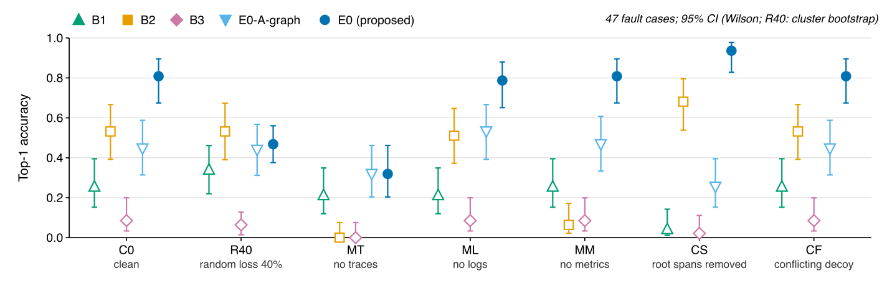
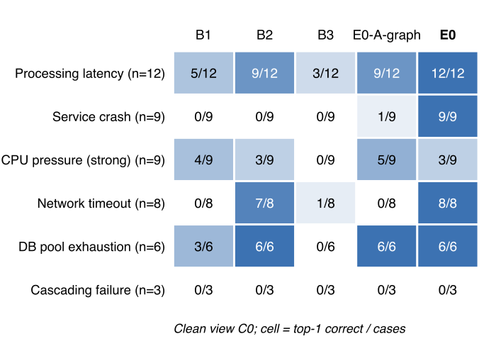
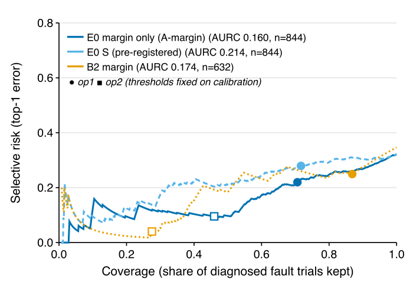
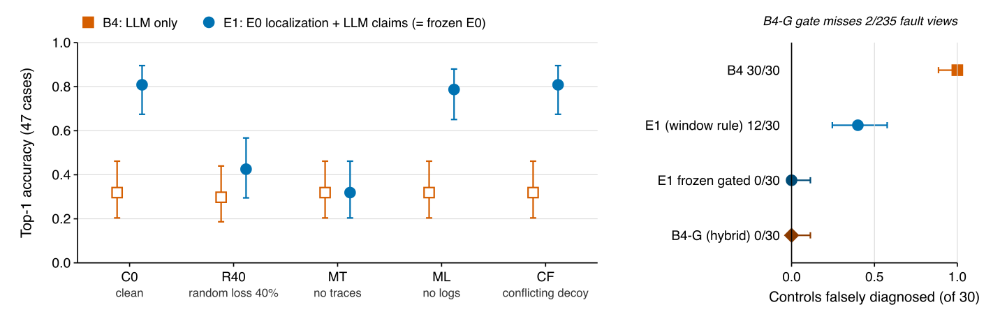
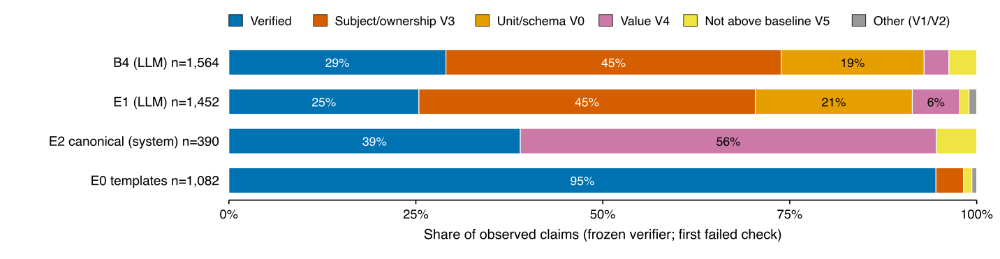

# Paper figures (auto-generated)

SVG is the source; PDF (for LaTeX) and PNG (preview) are converted with `rsvg-convert`.

## `fig_conf_localization`

*Confirmatory (frozen protocol, held-out test seeds 41/53/67).* Top-1 localization by telemetry view for E0 and the baselines (47 held-out fault cases).

## `fig_conf_fault_types`

*Confirmatory (frozen protocol, held-out test seeds 41/53/67).* Top-1 localization by fault type on C0; cascading failure and strong CPU pressure remain unsolved.

## `fig_conf_risk_coverage`

*Confirmatory (frozen protocol, held-out test seeds 41/53/67).* Risk-coverage curves of E0's abstention scores and B2's margin on the test seeds; the pre-registered composite S is worse than the margin alone.

## `fig_exp_diagnosis`

*Exploratory (Phase 4B, post-study; held-out seeds previously inspected for E0).* B4 (LLM only) versus E1 (E0 localization with LLM-written claims) by view, and false diagnoses on healthy controls.

## `fig_exp_claims`

*Exploratory (Phase 4B, post-study; held-out seeds previously inspected for E0).* Frozen-verifier outcome of observed claims (acceptance, not human-verified truth).

